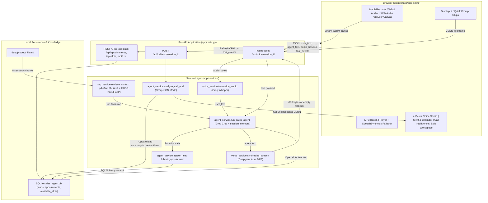
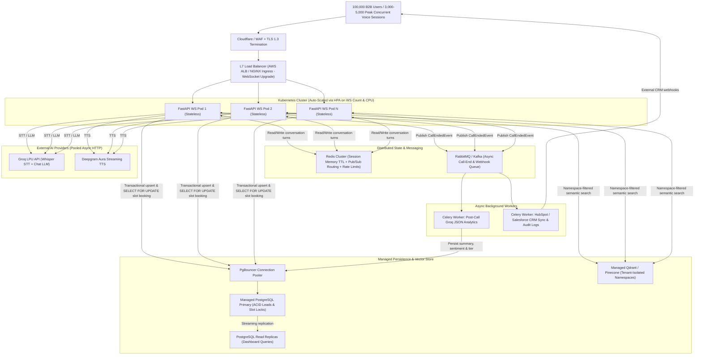

# Fortivex AI · Forvi — Technical Architecture & Scalability Dossier

This document provides the end-to-end systems architecture, production scaling blueprint for **1,00,000 users**, sub-800ms latency engineering, security/compliance posture, and commercial unit economics for **Fortivex's Autonomous AI Sales Voice Agent ("Forvi")**.

---

## 1. Business Problem & Solution Architecture

### Business Context
B2B SaaS revenue teams lose high-intent pipeline due to:
- **Lead Decay:** Inbound prospects requesting pricing or demos outside business hours wait hours for SDR follow-up.
- **SDR Cost & Capacity Limits:** Scaling human SDR coverage across English, Hindi, and Hinglish shifts requires heavy headcount investment.
- **CRM Hygiene Gaps:** Unstructured call notes cause inaccurate lead scoring, missed follow-up actions, and calendar scheduling friction.

### Solution Overview
**Forvi** automates the entire top-of-funnel qualification and scheduling loop:
1. **Real-Time Conversational Voice/Text Loop:** Browser captures WebM audio (`MediaRecorder`) or text over a persistent WebSocket (`/ws/voice/{session_id}`).
2. **Grounded RAG Knowledge Retrieval:** Every turn queries a FAISS vector index (`ProductKnowledgeRAG`) built over `data/product_kb.md` so pricing tiers (Starter ₹9,999/mo, Growth ₹24,999/mo, Enterprise Custom), 7-day onboarding timelines, SOC 2 Type II / ISO 27001 controls, and the 14-day free trial policy are strictly factual.
3. **Live Tool Execution:** Groq function calling invokes `upsert_lead` and `book_appointment` against SQLite (`sales_agent.db`), immediately syncing the frontend **CRM & Calendar** view.
4. **Structured Post-Call Analytics:** `POST /api/call/end/{session_id}` extracts JSON RevOps intelligence (`summary_bullets`, `lead_score`, `sentiment`, `key_objections`, `next_action`) and persists it to the lead record.

---

## 2. Current End-to-End Prototype Architecture



### Module-Level Implementation Map
- **API & WebSocket Gateway (`app/main.py`):**
  - `lifespan` initializes SQLite tables (`init_db()`), seeds 6 upcoming business-hour slots (`seed_available_slots()`), builds the FAISS index (`init_rag()`), and pre-resolves active Groq chat and Whisper models (`warm_groq_chat_model()`, `warm_whisper_model()`).
  - `/ws/voice/{session_id}` handles both binary audio frames and JSON `{"type": "text", "text": "..."}` frames using `run_in_threadpool` so blocking SDK/HTTP calls do not stall the event loop.
- **RAG Service (`app/services/rag_service.py`):**
  - `ProductKnowledgeRAG.split_markdown_semantically()` performs heading-aware Markdown splitting (`max_chars=1100`), preserving `#` / `##` / `###` hierarchy context.
  - Embeds chunks using `SentenceTransformer("all-MiniLM-L6-v2")` (trying `local_files_only=True` first to eliminate offline Hub retries) and stores L2-normalized vectors in `faiss.IndexFlatIP`.
- **AI Agent & Tooling (`app/services/agent_service.py`):**
  - `resolve_groq_chat_model()` checks `GROQ_MODEL` first, otherwise queries `client.models.list()` once, excludes `whisper`/`guard`/`tts`/`playai`/`orpheus`/`safeguard` and inactive models, prefers `"llama-4"`, `"qwen"`, `"gpt-oss"`, `"gemma"`, and caches the selected model thread-safely.
  - Before every LLM call, `run_sales_agent()` injects fresh `retrieve_context(user_text, top_k=3)` and open `available_slots` into Forvi's system prompt, capping `session_memory` at `MAX_MEMORY_MESSAGES = 30` and tool loops at `MAX_TOOL_ROUNDS = 4`.
  - `upsert_lead()` performs partial-safe upserts keyed by `session_id`; `book_appointment()` normalizes ISO timestamps to naive UTC, prevents double-booking (`is_booked`), links `lead_id`, and inserts into `appointments`.
- **Voice Service (`app/services/voice_service.py`):**
  - `transcribe_audio()` resolves and caches an active Whisper model (`whisper-large-v3-turbo` -> `whisper-large-v3`) via `client.models.list()`.
  - `synthesize_speech()` posts to Deepgram Aura (`https://api.deepgram.com/v1/speak?model=aura-asteria-en`), returning `b""` on missing keys or HTTP errors so the frontend smoothly triggers `window.speechSynthesis`.

---

## 3. Production Scalability Strategy for 1,00,000 Users

### Concurrency & Capacity Modeling
Assuming **100,000 total registered/active business users** across B2B tenant organizations:
- **Peak Concurrency Assumption (3%–5%):** `3,000 to 5,000` simultaneous active voice WebSocket sessions during peak business hours (10:00 AM – 6:00 PM IST/EST).
- **Turn Rate:** Average 1 voice/text turn every `8–10 seconds` per active call -> `~350–600 turns/sec` peak throughput across STT + RAG + LLM + TTS.
- **Memory & Connection Footprint:** At ~2,000 concurrent WebSockets per worker group or ~250 WebSockets per FastAPI Uvicorn pod (keeping memory < 1.5 GB/pod), peak load requires **16–24 stateless API pods** (auto-scaled via Kubernetes HPA).

### Production Cloud Architecture Diagram



### Key Architectural Upgrades for 100k Scale
1. **Stateless FastAPI Containers + Kubernetes HPA:**
   - Remove all process-local state (`session_memory`, local FAISS file, local SQLite file) from container memory.
   - Configure Kubernetes Horizontal Pod Autoscaler (HPA) using custom Prometheus metrics (`active_websocket_connections` + CPU utilization > 65%) and PodDisruptionBudgets with graceful WebSocket drain on scale-in.
2. **Distributed Session Memory & Routing in Redis:**
   - Store conversation histories (`session:{session_id}:messages`) in Redis Cluster as JSON lists/hashes with a 24-hour TTL (`MAX_MEMORY_MESSAGES = 30`).
   - Use **Redis Pub/Sub** (`channel:session:{session_id}`) so if a client drops and reconnects to a different pod behind the L7 Load Balancer, session state and pending events remain seamless without sticky-session bottlenecks.
3. **Async Post-Call Analytics via Celery/RabbitMQ or Kafka:**
   - When `POST /api/call/end/{session_id}` is triggered, the API pod enqueues a `CallEndedEvent` onto RabbitMQ/Kafka and immediately returns `202 Accepted` (or streams completion via WebSocket/SSE).
   - Dedicated Celery workers pull the transcript from Redis, run `analyze_call_end()` (Groq JSON mode), update PostgreSQL, and dispatch HubSpot/Salesforce webhooks asynchronously.
4. **PostgreSQL + PgBouncer + Concurrency-Safe Slot Booking:**
   - Replace SQLite with Managed PostgreSQL behind **PgBouncer** (transaction pooling mode) to handle thousands of short tool transactions without exhausting DB connections.
   - Guard `book_appointment()` with `SELECT ... FOR UPDATE SKIP LOCKED` on `available_slots` so concurrent calls never double-book the same demo slot.
   - Route read-heavy dashboard endpoints (`GET /api/leads`, `GET /api/appointments`, `GET /api/slots`) to PostgreSQL Read Replicas.
5. **Managed Vector Database (Qdrant / Pinecone):**
   - Replace per-process `faiss-cpu` with a managed Qdrant or Pinecone cluster, indexing each customer's knowledge base under a strict `tenant_id` namespace/collection filter with async document re-indexing pipelines.

---

## 4. Latency Optimization Strategy (Target < 800ms End-to-End)

Real-time voice AI feels natural only when turn-around latency stays below **800ms**.

| Stage | Target Budget | Engineering Optimization |
|---|---|---|
| **1. Client Audio Framing** | `~60–100 ms` | Opus-encoded WebM chunks (`audio/webm;codecs=opus`) with client-side VAD (Voice Activity Detection) to end recording immediately on silence |
| **2. Groq Whisper STT** | `~140–190 ms` | Groq LPU-accelerated `whisper-large-v3-turbo` over persistent HTTP/2 keep-alive connections |
| **3. Vector RAG + Slot Lookup** | `~15–30 ms` | In-memory embedding cache (`all-MiniLM-L6-v2` warmed on startup) + Redis-cached open demo slots |
| **4. Groq LLM Inference** | `~180–260 ms` | Fast LPU inference (`resolve_groq_chat_model`), concise voice system prompt (2–3 sentences max), `max_tokens=300`, streaming token chunks |
| **5. Deepgram Aura TTS** | `~160–200 ms` | Low-latency Deepgram Aura (`aura-asteria-en`) sentence-level streaming TTS (sent as soon as the first complete sentence arrives from LLM stream) |
| **Total Turn Latency** | **`~555–780 ms`** | Within the `< 800ms` conversational threshold |

*Note:* The current frontend tracks and displays live round-trip turn latency (`performance.now()`) directly in the header (`latencyBadge` in `ms`).

---

## 5. Data Security, Privacy & Compliance

| Control Area | Prototype Baseline | Production Enterprise Implementation |
|---|---|---|
| **Transport Encryption** | CORS-configured FastAPI HTTP/WS | Mandatory `HTTPS` and `WSS` (`TLS 1.3`) terminated at Edge/WAF with HSTS |
| **Encryption at Rest** | Local SQLite DB | AES-256 encryption for PostgreSQL RDS, Redis, S3 call recordings, and Qdrant/Pinecone volumes (KMS-managed keys) |
| **PII Masking & Log Hygiene** | Structured JSON responses | Automated PII redaction middleware (masking `phone`, `email`, and transcript text) before logs reach CloudWatch/Datadog |
| **Tenant RAG Isolation** | Single `product_kb.md` index | Mandatory `tenant_id` filter enforced at the vector DB query layer + per-tenant encryption contexts |
| **Access Control (RBAC)** | Open prototype API | JWT / OAuth2 + SAML 2.0 SSO (Enterprise) with role-based permissions (`Admin`, `Sales Rep`, `Read-Only Analyst`) |
| **Compliance (GDPR / DPDP)** | Zero third-party training policy documented in `product_kb.md` | Configurable regional data residency (Mumbai / Frankfurt / US-East), automated retention TTLs, right-to-erasure pipelines (`DELETE /api/leads/{id}`), SOC 2 Type II & ISO 27001 controls |

---

## 6. Commercial Feasibility & Unit Economics

### A. Per-Minute Voice Interaction Cost (at Production Volume)
Assuming an average B2B qualification call lasts **4 minutes** (~12 user/agent turns, ~600 spoken agent characters/min):

| Cost Line Item | Pricing Assumption | Cost / Minute (USD) | Cost / Minute (INR @ ₹84/USD) |
|---|---|---|---|
| **Groq Whisper STT (`whisper-large-v3-turbo`)** | ~$0.04 / audio hour | `$0.0007` | `₹0.06` |
| **Groq LLM (Chat + RAG + Post-Call JSON)** | ~3,500 input + 400 output tokens / min | `$0.0035` | `₹0.29` |
| **Deepgram Aura TTS (`aura-asteria-en`)** | ~$0.015–$0.030 / 1k chars (~650 chars/min) | `$0.0180` | `₹1.51` |
| **Cloud Infra (K8s, Redis, PG, Vector DB)** | Amortized across peak/off-peak minutes | `$0.0055` | `₹0.46` |
| **Total AI Voice Agent Cost** | — | **`$0.0277 / min`** | **`₹2.32 / min`** |

- **Cost per 4-minute qualified call:** **~$0.11 (₹9.28)**.
- **Comparison vs. Human SDR:** An average B2B SDR costs **$3,500–$6,000/month** (or **₹45,000–₹80,000/month** in India) for ~160 working hours, yielding **~$0.36–$0.63/min** (or **₹4.70–₹8.30/min** in India / **₹30+/min** in US/EU) before training, attrition, and CRM data-entry overhead. Forvi operates at **~5x–15x lower unit cost** with instant 24/7 availability.

### B. Monthly Cloud Infrastructure Estimate at 100,000 Users
Assuming 100,000 users generating **2,500,000 voice minutes/month** (~625,000 calls/month, ~3,000–5,000 peak concurrent WS sessions):

| Infrastructure Component | Specification | Estimated Monthly Cost (USD) |
|---|---|---|
| **Kubernetes Compute (EKS/GKE)** | 12–24 stateless FastAPI pods + 6 Celery worker nodes (spot/reserved blend) | `$1,800 – $2,600` |
| **L7 Load Balancing & Egress** | AWS ALB + CloudFront/WAF + WebSocket data transfer | `$450 – $700` |
| **Managed PostgreSQL + PgBouncer** | Multi-AZ Primary + 1 Read Replica (`db.r6g.xlarge`) | `$750 – $1,050` |
| **Managed Redis Cluster** | 3-node replicated cluster for session memory & Pub/Sub | `$350 – $500` |
| **Managed Vector DB (Qdrant/Pinecone)** | Multi-tenant index (~5M chunks, high-QPS SSD tier) | `$300 – $550` |
| **Observability & Secrets** | Prometheus/Grafana, log aggregation, KMS | `$250 – $400` |
| **Total Fixed/Semi-Variable Cloud Infra** | — | **`$3,900 – $5,800 / mo`** |

At Fortivex's **Starter (₹9,999/mo for 1,500 mins)** and **Growth (₹24,999/mo for 6,000 mins)** pricing tiers, variable AI + cloud cost (`~₹2.32/min`) yields **>75% gross margin** at scale.

---

## 7. Local Setup & Live Demo Guide

1. **Install dependencies:**
   ```powershell
   python -m venv venv
   .\venv\Scripts\Activate.ps1
   pip install -r requirements.txt
   ```
2. **Set `.env` keys:**
   ```env
   GROQ_API_KEY=your_groq_api_key_here
   DEEPGRAM_API_KEY=your_deepgram_api_key_here
   DATABASE_URL=sqlite:///./sales_agent.db
   ```
3. **Run the server:**
   ```powershell
   uvicorn app.main:app --reload
   ```
4. **Explore the Demo in Browser (`http://127.0.0.1:8000/`):**
   - **Voice Studio:** Click a quick prompt card or press **Speak** to talk to Forvi; watch the Web Audio `<canvas>` visualizer react to your microphone and Forvi's response.
   - **Split Workspace:** View Voice Studio and **CRM & Calendar** side-by-side to watch `upsert_lead` and `book_appointment` update SQLite live.
   - **Call Intelligence:** Click **End Call & Analyze** to trigger `POST /api/call/end/{session_id}` and review the executive summary, sentiment, Hot/Warm/Cold tier, objections, and next step.
