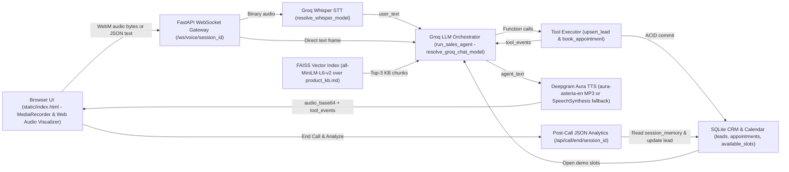

# Fortivex AI · Forvi — Autonomous AI Sales Voice Agent

**Forvi** is a real-time, RAG-grounded Autonomous AI Sales Voice Agent built for **Fortivex AI Suite**. It handles inbound B2B discovery calls over WebSockets, answers pricing, security, and onboarding questions grounded in product documentation, qualifies leads in real time via LLM function calling, books calendar demo slots atomically, and produces structured post-call RevOps intelligence.

> For deep-dive systems architecture, 100k-user horizontal scaling topology, latency budgeting, security controls, and cloud cost modeling, see [ARCHITECTURE.md](ARCHITECTURE.md).

---

## 1. Business Problem & Solution Overview

### The B2B Sales Bottleneck
1. **Slow Lead Response Times:** Industry benchmarks show B2B conversion rates drop sharply when inbound prospects wait hours—or even minutes—for an initial qualification callback.
2. **High SDR Operational Costs:** Hiring, training, and staffing human Sales Development Representatives (SDRs) across time zones and languages (English, Hindi, Hinglish) creates high fixed payroll overhead and low utilization during off-peak hours.
3. **Fragmented CRM & Calendar Updates:** Manual post-call note-taking leads to incomplete lead records, missed follow-ups, inconsistent qualification scoring, and double-booked demo slots.

### How Fortivex's Forvi Solves It
- **Instant Sub-Second Voice & Text Engagement:** Connects immediately over `/ws/voice/{session_id}` with streaming WebM audio capture, Groq Whisper STT, Groq LPU LLM inference, and Deepgram Aura TTS (with automatic browser `SpeechSynthesis` fallback).
- **Zero-Hallucination Product Grounding (FAISS RAG):** Before every LLM turn, semantic chunks from `data/product_kb.md` are retrieved via `all-MiniLM-L6-v2` + FAISS (`IndexFlatIP`) and injected into the system prompt so pricing, SLAs, SOC 2/ISO 27001 controls, and 14-day trial rules remain accurate.
- **Autonomous CRM & Calendar Execution:** Groq function calling (`upsert_lead` and `book_appointment`) captures contact details, budget, and qualification scores directly into SQLite (`sales_agent.db`) while reserving open slots in `available_slots` without double-booking.
- **Automated Post-Call Intelligence:** Calling `POST /api/call/end/{session_id}` analyzes the full session transcript via Groq JSON mode to extract bulleted summaries, `Hot | Warm | Cold` qualification tiers, `Positive | Neutral | Negative` sentiment, key objections, and recommended next actions.

---

## 2. End-to-End System Architecture



### Core Technology Stack
| Layer | Implementation in Repository |
|---|---|
| **Frontend Console** | Single-page Carbon Teal & Mint Foam UI in `static/index.html` (Tailwind CSS CDN, Plus Jakarta Sans / Inter / JetBrains Mono, HTML5 `<canvas>` Web Audio frequency visualizer, 4-view segmented switcher) |
| **API & WebSocket Server** | FastAPI + Uvicorn (`app/main.py`) with `run_in_threadpool` offloading for blocking I/O |
| **Speech-to-Text (STT)** | Groq Whisper (`app/services/voice_service.py` — dynamically resolves active `whisper-large-v3-turbo` / `whisper-large-v3` via `client.models.list()`) |
| **LLM Orchestration** | Groq Chat Completions (`app/services/agent_service.py` — dynamically resolves active chat model via `client.models.list()` or `GROQ_MODEL`, with per-session memory and tool calling) |
| **RAG Engine** | `sentence-transformers` (`all-MiniLM-L6-v2`) + `faiss-cpu` (`IndexFlatIP`) over `data/product_kb.md` (`app/services/rag_service.py`) |
| **Text-to-Speech (TTS)** | Deepgram Aura REST API (`aura-asteria-en`, MP3) with resilient `b""` fallback to browser `window.speechSynthesis` |
| **Database & ORM** | SQLAlchemy 2.0 + SQLite (`app/database.py`, `app/models.py`) with `leads`, `appointments`, and auto-seeded `available_slots` |

---

## 3. Production Scalability Strategy (100,000 Users)

While the local prototype runs a single FastAPI process with in-memory `session_memory`, `faiss-cpu`, and SQLite, [ARCHITECTURE.md](ARCHITECTURE.md) details the cloud-native evolution for **100,000 total users (~3,000–5,000 peak concurrent voice sessions)**:

- **Stateless WebSocket Pods + L7 Load Balancing:** Horizontally scaled FastAPI containers behind AWS ALB / NGINX with Kubernetes HPA scaling on active WebSocket connections and CPU utilization.
- **Distributed Session Memory (Redis):** Replaces in-memory `session_memory` (`dict[session_id, list[messages]]`) with Redis Cluster TTL hashes + Redis Pub/Sub for cross-pod state consistency and reconnect resilience.
- **Non-Blocking Post-Call Workers:** Offloads `analyze_call_end` LLM summarization, CRM webhook sync, and audit logging to Celery/RabbitMQ or Kafka workers so call teardown completes in `< 50ms`.
- **Database & Vector Scaling:** Migrates SQLite (`sales_agent.db`) to Managed PostgreSQL (Primary + Read Replicas) behind PgBouncer connection pooling, and migrates local FAISS to Managed Qdrant or Pinecone with per-tenant metadata namespaces.

---

## 4. Latency Optimization Strategy (Target < 800ms)

| Pipeline Stage | Target Budget | Optimization Technique |
|---|---|---|
| **Audio Transport & STT** | `~180–250 ms` | Short WebM/Opus voice turns + Groq Whisper `whisper-large-v3-turbo` |
| **RAG + Slot Lookup** | `~15–30 ms` | Pre-warmed in-memory `all-MiniLM-L6-v2` + FAISS `IndexFlatIP` (`init_rag()` at startup) |
| **LLM Inference** | `~200–300 ms` | Groq LPU inference with cached active model ID (`resolve_groq_chat_model`), `max_tokens=300`, and 2–3 sentence voice prompt constraint |
| **TTS Synthesis** | `~180–220 ms` | Deepgram Aura (`aura-asteria-en`) low-latency REST synthesis over pooled `httpx`, falling back cleanly to local `speechSynthesis` |
| **End-to-End Turn Latency** | **`~575–800 ms`** | Measured live in the UI header (`latencyBadge` in ms) |

---

## 5. Security, Privacy & Compliance

- **Encryption in Transit & at Rest:** WSS (`TLS 1.3`) for WebSocket audio/text frames and HTTPS for REST APIs; AES-256 encryption for PostgreSQL, Redis snapshots, object storage, and vector indexes.
- **PII Protection & Logging Hygiene:** Phone numbers, emails, and transcripts are excluded from application stdout logs and masked before telemetry/observability export.
- **Tenant-Isolated RAG & RBAC:** Production vector queries enforce `tenant_id` namespace filters; CRM/appointment endpoints enforce JWT + RBAC scoping.
- **Regulatory Alignment:** Aligned with GDPR and India's DPDP Act (configurable regional data residency, explicit recording consent, and zero training of public foundation models on customer call data).

---

## 6. Commercial Feasibility & Unit Economics

### Per-Minute Voice AI Cost vs. Traditional Human SDR
| Cost Component | Estimated Cost / Minute (USD) | Estimated Cost / Minute (INR @ ₹84/USD) | Notes |
|---|---|---|---|
| **Groq Whisper STT (`whisper-large-v3-turbo`)** | `$0.0007` | `₹0.06` | ~$0.04/hour audio transcription |
| **Groq LLM Inference (Input + RAG + Output)** | `$0.0030 – $0.0080` | `₹0.25 – ₹0.67` | ~2–4 short turns/min with cached context |
| **Deepgram Aura TTS (`aura-asteria-en`)** | `$0.0150 – $0.0240` | `₹1.26 – ₹2.02` | ~500–800 spoken characters/min |
| **Cloud Compute & DB Overhead** | `$0.0040 – $0.0070` | `₹0.34 – ₹0.59` | Stateless FastAPI pods, Redis, PostgreSQL |
| **Total Autonomous Voice Agent Cost** | **`~$0.023 – $0.040 / min`** | **`₹1.91 – ₹3.34 / min`** | **24/7 availability, zero ramp time** |
| **Traditional B2B Human SDR (Loaded Cost)** | **`~$0.35 – $0.85 / min`** | **`₹29.40 – ₹71.40 / min`** | Salary, benefits, tooling, management & idle time |

> **Result:** Forvi delivers **~88%–95% lower cost per qualified conversation minute** while eliminating after-hours lead drop-off and manual CRM entry. *(Full 100k-user monthly cloud infrastructure bill breakdown is provided in [ARCHITECTURE.md](ARCHITECTURE.md#6-commercial-feasibility--unit-economics).)*

---

## 7. Project Structure

```text
fortivex/
├── app/
│   ├── __init__.py
│   ├── database.py             # SQLAlchemy engine, SessionLocal, init_db & 6-slot startup seeding
│   ├── main.py                 # FastAPI routes, CORS, /static mount, /ws/voice/{session_id}
│   ├── models.py               # Lead, Appointment, AvailableSlot ORM models
│   ├── schemas.py              # Pydantic v2 request/response schemas
│   └── services/
│       ├── __init__.py
│       ├── agent_service.py    # Forvi persona, RAG injection, Groq tools, call-end JSON analytics
│       ├── rag_service.py      # ProductKnowledgeRAG (all-MiniLM-L6-v2 + FAISS IndexFlatIP)
│       └── voice_service.py    # Groq Whisper STT + Deepgram Aura TTS (with fallback)
├── data/
│   └── product_kb.md           # Fortivex AI Suite B2B SaaS knowledge base
├── static/
│   └── index.html              # 4-view Carbon Teal / Mint Foam Gemini-style Voice Console
├── .env.example                # Environment variable template
├── requirements.txt            # Python dependencies
├── README.md                   # Overview, setup & evaluation summary
└── ARCHITECTURE.md             # Round 3 systems architecture, 100k scaling & unit economics
```

---

## 8. Local Setup & Live Demo Guide

### Prerequisites
- Python 3.11+ (tested on Python 3.12.1)
- A valid `GROQ_API_KEY` (required for chat, post-call JSON analytics, and Whisper STT)
- A valid `DEEPGRAM_API_KEY` (optional — if omitted or unreachable, the UI automatically falls back to browser `window.speechSynthesis`)

### Step-by-Step Setup
1. **Create and activate a virtual environment:**
   ```powershell
   python -m venv venv
   .\venv\Scripts\Activate.ps1
   ```
   *(On macOS/Linux: `source venv/bin/activate`)*

2. **Install dependencies:**
   ```powershell
   pip install -r requirements.txt
   ```

3. **Configure environment variables:**
   ```powershell
   Copy-Item .env.example .env
   ```
   Update `.env` with your keys:
   ```env
   GROQ_API_KEY=your_groq_api_key_here
   DEEPGRAM_API_KEY=your_deepgram_api_key_here
   DATABASE_URL=sqlite:///./sales_agent.db
   ```

4. **Start the FastAPI server:**
   ```powershell
   uvicorn app.main:app --reload
   ```
   On startup, `lifespan` automatically:
   - Creates `leads`, `appointments`, and `available_slots` tables in `sales_agent.db` (`init_db()`).
   - Seeds 6 upcoming business-hour demo slots if `available_slots` is empty (`seed_available_slots()`).
   - Indexes `data/product_kb.md` into FAISS (`init_rag()`).
   - Pre-resolves active Groq chat and Whisper models (`warm_groq_chat_model()`, `warm_whisper_model()`).

5. **Open the Live Console:**
   Navigate to `http://127.0.0.1:8000/` in a modern browser (Chrome/Edge recommended for `MediaRecorder` WebM audio).

### API & WebSocket Verification Endpoints
| Endpoint | Method | Purpose |
|---|---|---|
| `/` | `GET` | Serves the single-page Voice Studio & CRM console (`static/index.html`) |
| `/health` | `GET` | Health check (`{"status": "ok"}`) |
| `/api/leads` | `GET` | Lists captured CRM leads ordered newest-first |
| `/api/appointments` | `GET` | Lists booked discovery/demo appointments |
| `/api/slots` | `GET` | Lists consultation slots and `is_booked` state |
| `/api/chat` | `POST` | Text chat test endpoint (`{"session_id": "...", "message": "..."}`) |
| `/api/call/end/{session_id}` | `POST` | Runs post-call Groq JSON analytics and updates matching `Lead` row |
| `/ws/voice/{session_id}` | `WS` | Real-time bidirectional voice (binary WebM) & JSON text turn endpoint |

#### Quick CLI Smoke Test
```powershell
# Check seeded calendar slots
curl http://127.0.0.1:8000/api/slots

# Test text agent & RAG grounding
curl -X POST http://127.0.0.1:8000/api/chat `
  -H "Content-Type: application/json" `
  -d '{"session_id":"demo-101","message":"Hi, I am Riya from Acme. What does the Growth plan cost?"}'

# Inspect captured leads and run post-call analytics
curl http://127.0.0.1:8000/api/leads
curl -X POST http://127.0.0.1:8000/api/call/end/demo-101
```
